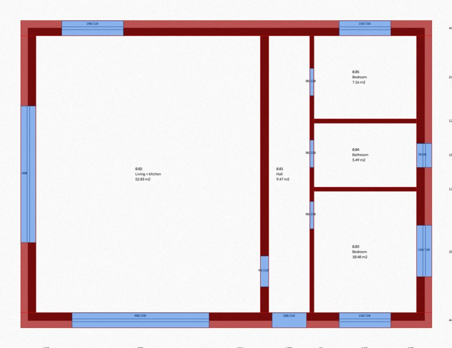
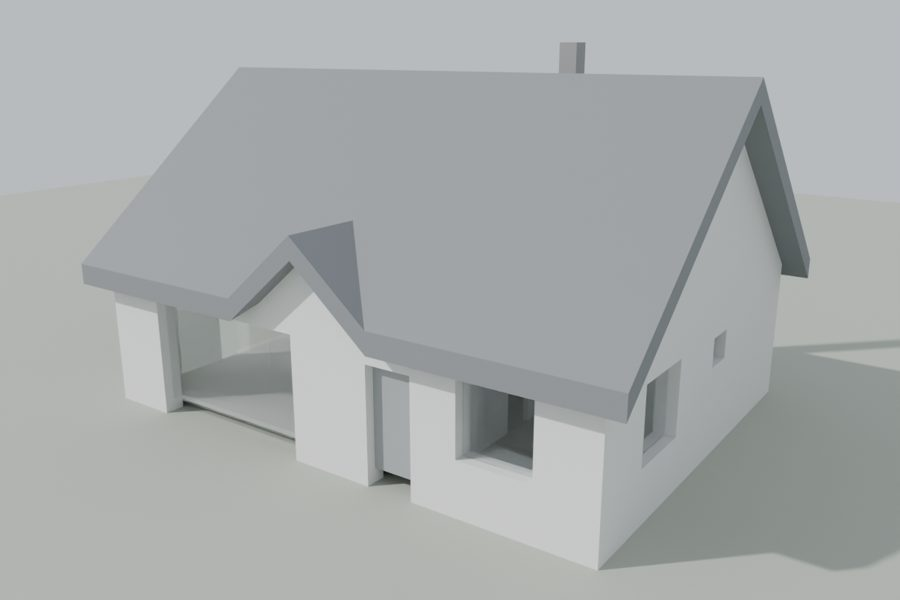
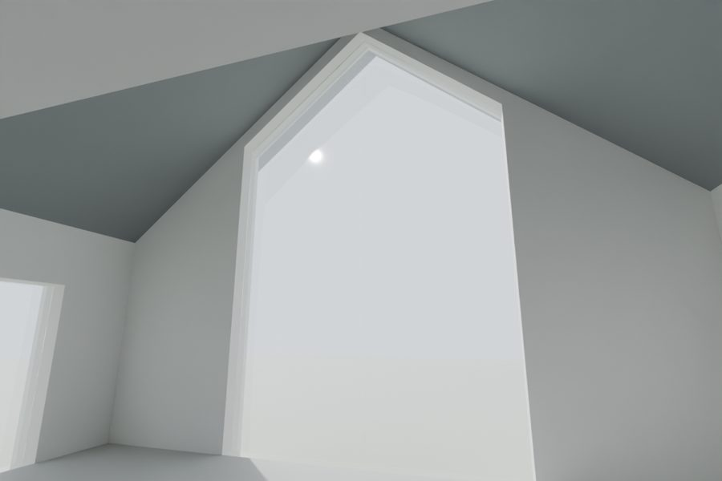
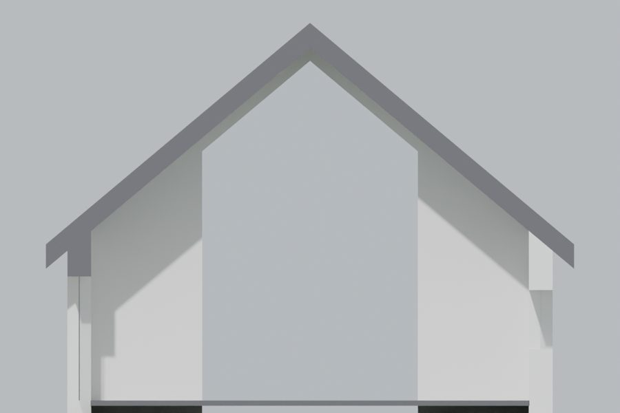

# house-from-plans

Turn a house's permit drawings into a measured Blender model, with a coding agent
(Claude Code or Codex) doing the work and automatic checks against the drawings' own numbers.

<p>




</p>

The pictures are the fictional house in `examples/simple-house`, built with `make example`.

What you get for your own house:
- `plan.json`: every wall, opening, room, level and roof wing, each with the sheet it came from,
- a Blender model built from it by a script, so a correction is one edit and a rebuild,
- checks: every room area against the room table (1 %), usable area, footprint, envelope,
  ridge height, height above ground, roof pitch,
- an overlay of `plan.json` on the scanned floor plan, so a misplaced wall is visible,
- review stills from fixed cameras: plan cut at 1.20 m, exterior, interiors at eye height, section,
- variants: your changes to the design as a separate layer on top of the permit version.

Not included (yet): furniture, baked light, a walkable web viewer. See "After the model".

Expect roughly a day of agent time for a typical single-family house from scans, most of it
reading dimension chains, and about an hour of your time for inputs and answers. Vector PDFs or
a CAD file make it much faster.

---

## 1. Inputs

Put the drawings in `house/sources/`. They are git-ignored; keep it that way.

**Required**
| Input | Used for |
|---|---|
| Ground floor plan, 1:100 or 1:50, with all dimension chains | walls, openings, rooms. PDF from the architect is best; a scan at 300 dpi or more, flat, whole sheet |
| Roof plan | wings, ridges, pitch, overhangs, chimneys |
| Sections (at least the one through the tallest room) | floor, ceiling, slab, attic, eaves, ridge levels |
| Elevations | sills, heads, glazing shapes (e.g. a gable window up to the roof slope) |
| Room table with areas (usually in the technical description) | the main correctness check |
| Wall build-up | wall thicknesses and layers |

**Recommended**
| Input | Used for |
|---|---|
| Upper floor / attic plan | second level |
| Site plan | north, terrace, driveway, plot |
| Building data: footprint, usable area, max height | extra checks |
| DWG / IFC / SketchUp from the architect | skips most of the transcription. Ask once |

**Your changes to the design.** A short list with numbers: "opening over the living room
bigger by 120 cm towards the kitchen", "stair to the attic, 80 cm wide, 16 risers of 18 cm".
A sketch on the plan helps, but only stated numbers are used. Anything without a number is a
question, not a guess.

**Decide before starting** (answer in the kickoff prompt):
1. Variant first: as permitted (A), or with your changes (B on top of A). Building A first and
   B as a variant is worth it: A is the one the room table can check.
2. Is "up" on the drawing north? If unsure, the site plan settles it.
3. Which views you want to review (default: plan, exterior from the entrance, main room,
   corridor, one section).

## 2. Setup (macOS, about 30 min)

1. [Claude Code](https://docs.claude.com/en/docs/claude-code) (`npm install -g @anthropic-ai/claude-code`)
   or Codex. Run it in this folder; it picks up `AGENTS.md` / `CLAUDE.md`.
2. [Blender](https://www.blender.org/download/) 4.2 or newer (tested on 5.1). The agent runs it
   headless; the GUI is for you to look at the result. Other OS: `make ... BLENDER=/path/to/blender`.
3. Python 3.11+, then `make setup`.
4. Try the example: `make example`. Output in `examples/simple-house/out/v1/`.
5. Clone this repo per house, or keep your house in `house/` (git-ignored by default, so your
   plan does not end up public if you push). If your fork is private, remove `house/` from
   `.gitignore` and commit `plan.json` as you go.

Optional: Blender MCP, so the agent can look at a live Blender scene. Not needed here.

## 3. Pipeline

The agent follows `AGENTS.md`. In short:

1. **Transcribe** the drawings into `house/plan.json` (format in `AGENTS.md`). Calibrate the scan
   once from two overall chains (`tools/calibrate.py`). Numbers come from chains and labels;
   scans are stretched unevenly, so the image only places walls.
2. **Check** with `make check` and `make overlay`. Find the area rule first: room tables usually give
   the structural interior minus the plaster per face (`meta.plaster_cm`); once a rule holds on a
   few rooms, the rest should check out. A failing room is reported, never fudged.
   ⛔ **Gate 1**: the owner looks at the check table and the overlay.
3. **Build** with `make render V=v1` (add `FAST=1` for quick previews). The model check compares
   ridge, height, size and pitch with the drawings.
   ⛔ **Gate 2**: the owner reviews the stills. Then changes go in as variant B and get built as
   a new version.

Every build goes to a new `out/<version>/`; nothing is overwritten. `BUILD_LOG.md` in the house
folder records what each version contains.

## 4. Kickoff prompt

Paste into Claude Code (or Codex) in this folder, filled in:

```text
Read README.md and AGENTS.md. We are building a measured Blender model of my house.

Drawings in house/sources/: <files, e.g. ground_floor.pdf, roof.jpg, section_AA.jpg,
elevations.pdf, description.pdf (room table on page N)>.

1. Variant first: <A as permitted / B with my changes>
2. Drawing up is north: <yes / no / unknown>
3. Views: <default / list>

My changes to the design: <list with numbers, or "none for now">

Start house/ from examples/simple-house. Never invent a dimension; ask me.
Stop at Gate 1 and Gate 2. Commit after each step and keep house/BUILD_LOG.md.
```

## 5. Lessons

- **Coplanar faces render black in Cycles.** Typical cases: walls
  meeting the roof edge, slab edges meeting walls, a chimney face on an attic wall, two lintels in
  the same place. The build avoids the known ones (walls end exactly on the roof underside, slabs
  run 1 cm into walls, voids reach past walls, panes are inset). A new black stripe means two
  faces in one plane: move one by a few mm.
- **Plan view:** an ortho camera with clip start 1.20 m above the floor gives a real plan cut.
  Looking down from far above shows lintels instead.
- **Section:** camera clipping leaves the cut open and black; a boolean cutter that transfers its
  material caps it (`blender/shots.py`).
- **Check what a height really is.** A number that looks like the ridge can be the top of the
  chimneys. Sections plus the max height in the description settle it.
- **Catalog designs are often built mirrored.** Check orientation against the site plan.
- **Shader nodes by type, not by name.** Names are localized in non-English Blender.
- **AI image tools do not keep architecture** when asked to design a room from text. They do
  well when given a render of this model as image 1 (layout and camera locked) and a style photo
  as image 2 (style only). Do the layout in Blender, use AI for finishes.

## 6. After the model

Separate sessions, each with its own plan:
1. **Furniture**: approve a top-view layout first, then place items. Built-ins (wardrobes,
   kitchen runs) as scripted boxes; sofas, beds, lamps from Poly Haven or Sketchfab, CC0 or
   CC BY only (never NC if anything goes public), max ~30k triangles each, licence and author
   logged per asset.
2. **Photoreal stills**: render 3 to 5 furnished views of one room, then in ChatGPT upload them
   (architecture locked) plus one style photo (style only); one view first, the rest after you
   approve it. List in the prompt what must not change and what may.
3. **Walkable viewer**: `--glb out.glb` exports the model (one node per collection); a Three.js
   page with WASD at 1.60 m and collisions from `plan.json`. Baked light looks real but takes
   around an hour per full bake on a laptop GPU and every furniture change means a re-bake. Leave it last.

Before showing anything publicly: no architect sheets or scans, no catalog design name, no
plot number, address or names, and no GPS metadata in photos.

## Layout

| Path | Role |
|---|---|
| `AGENTS.md` | rules for the agent, `plan.json` reference, commands |
| `blender/build_model.py` | builds the .blend and `geometry_reference_<variant>.json` from plan.json |
| `blender/shots.py` | review cameras from `shots.json`, section cut, clay render |
| `tools/plan.py` | loads plan.json and applies a variant |
| `tools/roof.py` | roof surface and planar facets from the wings |
| `tools/check_plan.py`, `tools/check_model.py` | checks against the drawings |
| `tools/calibrate.py`, `tools/scanlib.py`, `tools/overlay.py` | scan calibration and overlay |
| `tools/make_example_scan.py` | draws the example's fake scan |
| `examples/simple-house/` | fictional single-storey house with a cross gable and a room open to the roof |

MIT licence.
